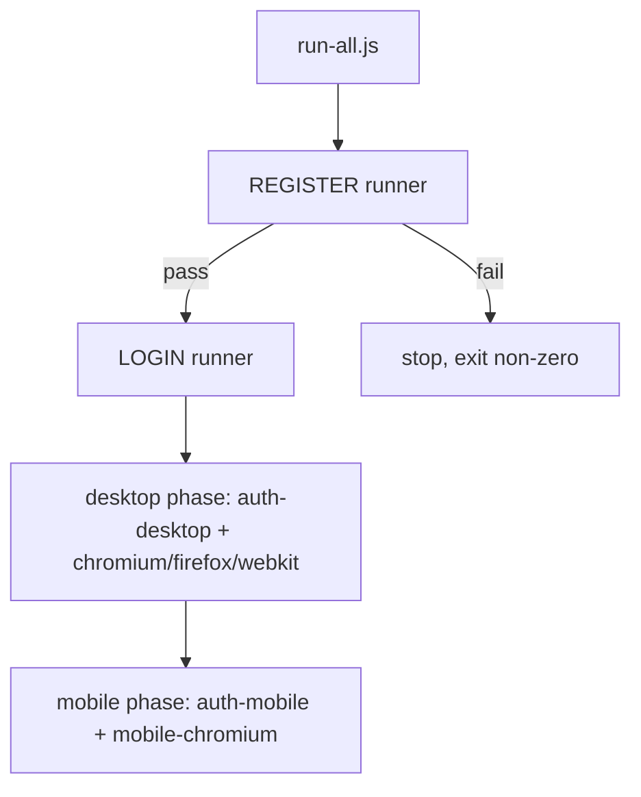
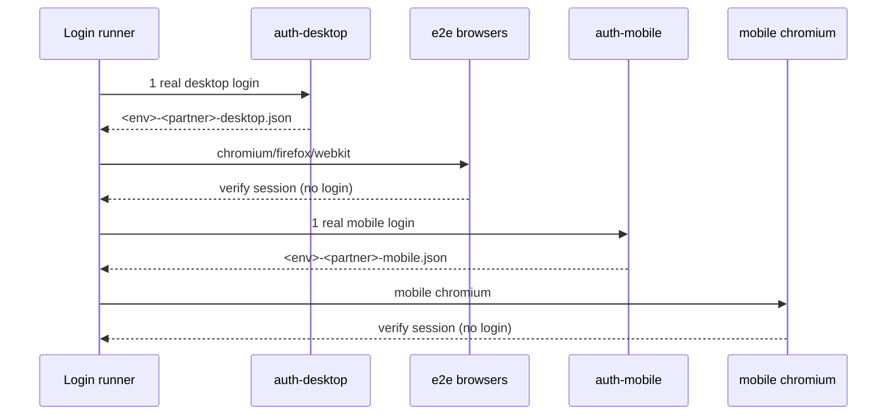

# Cazweb Automation

End-to-end Playwright framework for the Cazweb partner sites (TotoGaming,
Totoro, Cozbet Shared, Betfa). It runs the same suites against multiple
partners and environments, on desktop and mobile browsers, and merges every run
into one HTML report per feature.

The framework is built so a tester mainly works in `tests/`, `src/pages/` and
`tests/data/`. Authentication, artifacts, partner configuration and orchestration
are handled for you.

## 1. Introduction

- **Multi-partner / multi-environment** — partners are declared in
  `src/config/partners.js`; each declares its environments (`test`, `prod`) and
  feature flags. Credentials come from `.env`.
- **Real login once, verify everywhere** — a real login is performed only by the
  dedicated auth projects (`auth-desktop`, `auth-mobile`). Browser projects reuse
  the saved session and only verify the logged-in UI.
- **Feature isolation** — every feature writes its own artifact tree
  (`artifacts/<feature>/{blob,test-results,report}`), so Login and Register never
  touch each other.
- **Tagged tests** — tests carry plain-string tags (`@positive`, `@negative`,
  `@smoke`, `@regression`). The default run is positive-only.

## 2. How It Works

### Runners

There are two feature runners plus a top-level orchestrator:

- `scripts/run-register-all-partners.js` — registration only. **No auth, no
  login, no storageState.**
- `scripts/run-login-all-partners.js` — login only, in two sequential phases per
  partner: desktop (one real login → Chromium/Firefox/WebKit) then mobile (one
  real login → mobile Chromium).
- `scripts/run-all.js` — runs Register, then Login.



### Login authentication flow

A partner account allows only one active session, so desktop and mobile auth must
never overlap for the same partner. That is why each partner's phases run
sequentially, while different partners run concurrently.



### Artifacts and combined report

Each runner spawns Playwright with the `blob` reporter into its own feature
folder, then `playwright merge-reports` builds one self-contained HTML report for
that feature. Register and Login reports are separate.

## 3. Technical Documentation

### Project structure

```
src/
  config/       partners.js, env.js, index.js, storageState.js, testFilters.js
  pages/        BasePage + auth/LoginPopup, RegisterPopup, Betfa* popups
  factories/    loginRegistry.js, registerRegistry.js (partner -> popup class)
  fixtures/     base.js (test + runtime/api fixtures)
  utils/        automation.js, device.js, helpers.js
tests/
  auth/         login.spec.js, register.spec.js
  support/      authSetup.js, setup.desktop.spec.js, setup.mobile.spec.js
  data/         registerData.js
scripts/
  run-all.js, run-login-all-partners.js, run-register-all-partners.js
  lib/          runAllPartners.js (engine), artifacts.js (feature paths)
playwright.config.js
```

### Playwright projects

| Project | Purpose | Auth |
|---|---|---|
| `auth-desktop` | Real desktop login → `<env>-<partner>-desktop.json` | yes |
| `auth-mobile` | Real mobile login → `<env>-<partner>-mobile.json` | yes |
| `e2e-chromium` / `e2e-firefox` / `e2e-webkit` | Login session checks (reuse desktop state) | reuse |
| `e2e-mobile-chromium` | Login session check (reuse mobile state) | reuse |
| `register-chromium` / `register-mobile-chromium` | Registration, logged out | none |
| `visual` | Visual regression (Chromium) | reuse |

### Environment variables

| Variable | Purpose | Default |
|---|---|---|
| `PARTNER` | target partner id | `totogaming` |
| `PLAYWRIGHT_ENV` | `test` \| `prod` | `test` |
| `TEST_TYPE` | `positive` \| `negative` \| `all` | `positive` |
| `TEST_TAG` | `smoke` \| `regression` | – |
| `PW_VIDEO` | `on` to keep videos of failed tests | off |
| `PW_FEATURE` | scope artifacts of **direct** `playwright test` runs | – |
| `PW_ARTIFACTS_DIR` | move the whole artifact root (e.g. off OneDrive) | `./artifacts` |
| `<PREFIX>_<ENV>_USERNAME` / `_PASSWORD` | partner credentials (see `.env.example`) | – |

### Setup

```bash
npm install
npx playwright install        # browsers
cp .env.example .env          # then fill credentials
```

### Running tests

```bash
# One partner
node scripts/run-login-all-partners.js totogaming
node scripts/run-register-all-partners.js totogaming

# All partners
npm run test:login:all
npm run test:register:all

# Full suite: REGISTER then LOGIN (fail-fast)
npm run test:suite
node scripts/run-all.js totogaming

# Include negative tests (LOGIN [02])
node scripts/run-login-all-partners.js totogaming --type=all
node scripts/run-all.js totogaming --type=all

# Direct Playwright (feature-scoped artifacts)
PW_FEATURE=login PARTNER=totogaming npx playwright test --project=e2e-chromium
```

Login runner flags: `--env=`, `--type=`, `--tag=`, `--parallel=<n>`
(partner concurrency, default 2), `--workers=<n>`, `--projects=`, and
`-- <playwright args>` passthrough. On memory-limited machines prefer
`--parallel=2 --workers=2` or `--parallel=1`.

### Adding a test

1. Add a spec under `tests/<feature>/`.
2. Add/extend a page object under `src/pages/`.
3. Put data under `tests/data/`.
4. Tag tests with `@positive` and/or `@negative` (and optionally `@smoke` /
   `@regression`). Import `test`/`expect` from `src/fixtures/base.js` when you
   need the `runtime`/`api` fixtures.

For a session-based test, declare the storage state per test, e.g.:

```js
test.use({ storageState: storageStatePath(envName, partnerId, 'desktop') });
```

### Adding a partner

1. Add an entry in `src/config/partners.js` (id, `displayName`, `envs` with
   `baseURL` + `credsEnvPrefix`, features).
2. Add credentials to `.env` using `<PREFIX>_<ENV>_USERNAME/_PASSWORD`.
3. If the login/register DOM differs, add a popup subclass under
   `src/pages/auth/` and register it in `src/factories/loginRegistry.js` or
   `registerRegistry.js`.
4. If registration data differs, add a builder in `tests/data/registerData.js`.

No runner changes are needed.

### Artifacts

```
artifacts/                      # or PW_ARTIFACTS_DIR
├── login/{blob,test-results,report}
└── register/{blob,test-results,report}
```

- `PW_FEATURE=<name>` makes direct `playwright test` runs use
  `artifacts/<name>/{test-results,report}`.
- `PW_ARTIFACTS_DIR=<path>` relocates the root (useful to keep large trees off
  OneDrive). Only generated artifacts move; source and tests stay in the repo.

### Known limitations

- A partner account allows one active session, so desktop and mobile auth for the
  same partner must not run concurrently; the runner already sequences them.
- Firefox occasionally fails to restore the saved storage state under heavy
  concurrent load (`Error setting storage state` / IndexedDB). It passes when run
  alone; no workaround is applied.
- On machines with low free RAM, parallel real logins can exceed timeouts; use
  `--workers=2` or `--parallel=1`.
- Two runners for the **same** feature at the same time (e.g. two Login runs for
  the same partner) still share the same storage-state file; run one at a time.