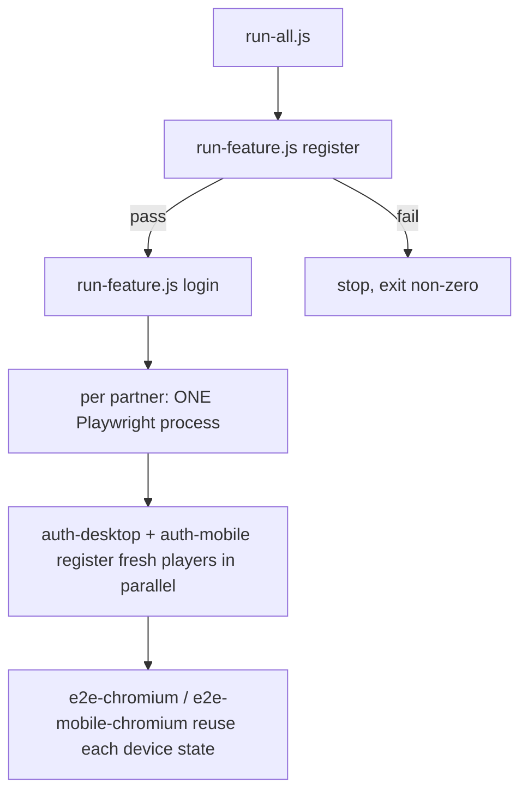
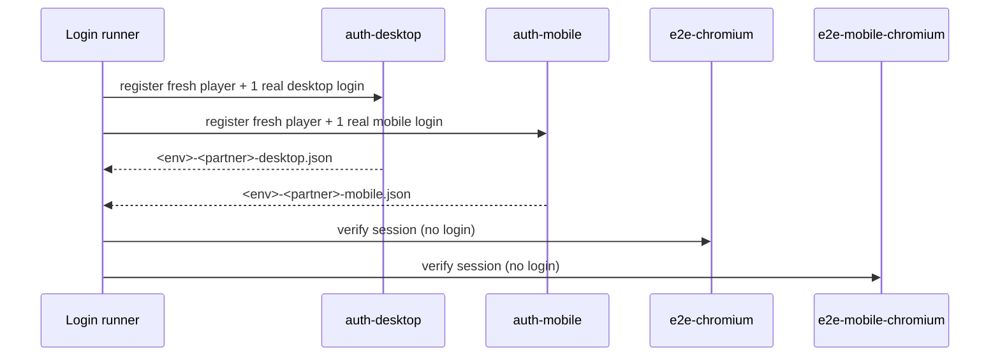

# Cazweb Automation

End-to-end Playwright framework for the Cazweb partner sites (TotoGaming,
Totoro, Cozbet Shared, Betfa). It runs the same suites against multiple
partners and environments, on desktop and mobile browsers, and merges every run
into one HTML report per feature.

The framework is built so a tester mainly works in `tests/`, `src/pages/` and
`tests/data/`. Authentication, artifacts, partner configuration and orchestration
are handled for you.

## 1. Introduction

- **Multi-partner / multi-environment** — partners are declared in
  `src/config/partners.js`; each declares its environments (`test`, `prod`),
  its `centrivoId` and feature flags.
- **Fresh player per run** — the auth projects register a brand-new player for
  every partner/device through the B2B Registration API, then log in with it.
  No shared `.env` account is used, so desktop and mobile (and multiple
  partners) never fight over one session.
- **Real login once, verify everywhere** — a real login is performed only by the
  dedicated auth projects (`auth-desktop`, `auth-mobile`). Browser projects reuse
  the saved session and only verify the logged-in UI.
- **Feature isolation** — every feature writes its own artifact tree
  (`artifacts/<feature>/{blob,test-results,report}`), so Login and Register never
  touch each other.
- **Tagged tests** — tests carry plain-string tags (`@positive`, `@negative`,
  `@smoke`, `@regression`). The default run is positive-only. A test can also be
  tagged `@desktop-only` to run on desktop only (see below).

## 2. How It Works

### Runners

Features are declared in `scripts/features.js` and run through ONE generic runner:

- `scripts/features.js` — the feature registry (spec, label, phases/projects,
  `enabled`). **Adding a feature = adding one entry here.** Set `enabled: false`
  to skip a feature in the full suite without deleting its config; it can still
  be run explicitly with `run-feature.js`.
- `scripts/run-feature.js <feature>` — generic runner. Looks the feature up and
  delegates to the shared engine `scripts/lib/runAllPartners.js`. Auth-dependent
  features run the whole chain in **one Playwright process per partner**
  (`auth-desktop` + `auth-mobile` + `e2e-chromium` + `e2e-mobile-chromium`);
  the two auth projects register their own fresh players in parallel, and each
  browser project starts as soon as its own auth project finishes (project
  `dependencies` enforce the order). Register is **auth-free** (no login, no
  storageState).
- `scripts/run-all.js` — top-level orchestrator. Runs the `SUITE` order from
  `scripts/features.js` (currently Register → Login) continue-on-failure: a
  failing feature no longer stops the rest, and the process exits non-zero with
  a summary of the failing features.

Both `run-feature.js` and `run-all.js` run **partners concurrently** up to
`--parallel=<n>` (default 2). Inside each partner process, browser-level
parallelism is governed by `--workers=<n>`.



### Login authentication flow

Each device registers its **own** fresh player via the B2B Registration API and
logs in with it, so desktop and mobile no longer share a session and can run in
parallel. Different partners also run in parallel (separate processes, separate
storage state).



### Artifacts and combined report

Each runner spawns Playwright with the `blob` reporter into its own feature
folder, then `playwright merge-reports` builds one self-contained HTML report for
that feature. Register and Login reports are separate.

## 3. Technical Documentation

### Project structure

```
src/
  api/          registerApi.js (B2B Registration API client)
  config/       partners.js, env.js, index.js, storageState.js, players.js, testFilters.js, authMarkers.js
  pages/        BasePage + auth/Login/ and auth/Register/ popups
  factories/    loginRegistry.js, registerRegistry.js (partner -> popup class)
  fixtures/     base.js (test + runtime fixture)
  utils/        automation.js, device.js, helpers.js
tests/
  scenarios/    auth/ (login.spec.js, register.spec.js), change_password/, dummy_lobby_page/
  support/      authSetup.js, setup.desktop.spec.js, setup.mobile.spec.js
  data/         registerData.js
  support/storageState/   <env>-<partner>-<device>.json (gitignored, session)
  support/players/        <env>-<partner>-<device>.json (gitignored, fresh creds)
scripts/
  features.js   feature registry (spec/label/phases/projects)
  run-feature.js  generic per-feature runner
  run-all.js    full-suite orchestrator (SUITE order, continue-on-failure)
  lib/          runAllPartners.js (engine), artifacts.js (feature paths)
playwright.config.js
```

### Playwright projects

| Project | Purpose | Auth |
|---|---|---|
| `auth-desktop` | Register a fresh player + real desktop login → `<env>-<partner>-desktop.json` | yes |
| `auth-mobile` | Register a fresh player + real mobile login → `<env>-<partner>-mobile.json` | yes |
| `e2e-chromium` / `e2e-firefox` / `e2e-webkit` | Session checks (reuse desktop state); `@mobile-only` excluded | reuse |
| `e2e-mobile-chromium` | Session checks (reuse mobile state); `@desktop-only` excluded | reuse |
| `register-chromium` / `register-mobile-chromium` | Registration UI, logged out | none |

### How tests run (parallel model)

- **Workers** — Playwright runs each test in its own browser process. `--workers=N`
  allows N tests to be in flight at once. A single test is atomic and never
  splits across workers.
- **Within a project** — tests parallelize across workers when
  `fullyParallel: true` (global default). `auth-*` and `visual` projects are
  `fullyParallel: false` (auth has one test per partner×env; visual stays
  sequential for stable screenshots).
- **Across projects** — a project with `dependencies:` starts only after its
  dependency finishes (`e2e-*` depend on their `auth-*`). Independent projects
  (e.g. `e2e-chromium` and `e2e-mobile-chromium`, or `register-*`) may run at the
  same time.
- **Across partners** — a single `npx playwright test` invocation targets **one**
  partner (`PARTNER`). To run several partners in parallel, use the runner
  scripts, which spawn one Playwright process per partner and run them
  concurrently up to `--parallel=<n>` (default 2). Storage state and player files
  are partner-scoped, so partners never collide.

### Desktop-only / mobile-only tests

To keep a test on desktop but skip it on mobile, tag it and let the config filter
it out (no device checks in the test body):

```js
test('CASHIER [03] ...', { tag: ['@positive', '@regression', '@desktop-only'] }, async ({ page }) => {
  /* ... */
});
```

`playwright.config.js` sets `grepInvert: /@desktop-only/` on
`e2e-mobile-chromium` (and `/@mobile-only/` on `e2e-chromium` for the mirror
case). `grepInvert` combines with the existing `grep` (type/tag filter).

### Environment variables

| Variable | Purpose | Default |
|---|---|---|
| `PARTNER` | target partner id | `totogaming` |
| `PLAYWRIGHT_ENV` | `test` \| `prod` | `prod` (an unconfigured env fails loudly instead of falling back) |
| `TEST_TYPE` | `positive` \| `negative` \| `all` | `positive` |
| `TEST_TAG` | `smoke` \| `regression` | – |
| `PW_VIDEO` | `on` to keep videos of failed tests | off |
| `PW_FEATURE` | scope artifacts of **direct** `playwright test` runs | – |
| `PW_ARTIFACTS_DIR` | move the whole artifact root (e.g. off OneDrive) | `./artifacts` |
| `TEST_API_URL` | B2B Registration API base URL (client appends `/Client/Register`) | – |
| `B2B_AUTH` | raw token sent in the `Authorization` header (no `Bearer`) | – |
| `<PREFIX>_<ENV>_USERNAME` / `_PASSWORD` | legacy shared accounts — reserved for future **Betting** tests only; auth/e2e suites now use freshly registered players | – |

### Setup

```bash
npm install
npx playwright install        # browsers
cp .env.example .env          # then fill TEST_API_URL and B2B_AUTH
```

Registering players requires `TEST_API_URL` and `B2B_AUTH` in `.env`; a missing
value fails the auth setup loudly (which skips every dependent project) rather
than falling back to a shared account.

### Running tests

**Direct Playwright — one partner, all projects (fastest to iterate):**

```bash
# totogaming, test env, positive tests (default), 2 workers
npx cross-env PLAYWRIGHT_ENV=test PARTNER=totogaming playwright test --workers=2

# include negative tests (LOGIN [02])
npx cross-env PLAYWRIGHT_ENV=test PARTNER=totogaming TEST_TYPE=all playwright test --workers=2

# feature-scoped artifacts, watch it run
npx cross-env PLAYWRIGHT_ENV=test PARTNER=totogaming PW_FEATURE=login playwright test --workers=2 --headed
```

A direct run executes every project: `auth-desktop` + `auth-mobile` register
fresh players and log in, then the `e2e-*` and `register-*` projects. Pass
`--project=<name>` to narrow it.

**Runner scripts — multiple partners in parallel:**

```bash
# one partner
node scripts/run-feature.js login totogaming --env=test --workers=2

# several partners, at most 3 concurrent (each its own process)
node scripts/run-feature.js login totogaming cozbet --env=test --parallel=3 --workers=2

# register is auth-free and runs partners in parallel too
node scripts/run-feature.js register totogaming cozbet --env=test --parallel=2

# full suite (SUITE order, continue-on-failure)
node scripts/run-all.js totogaming cozbet --env=test --parallel=2 --workers=2
# or the npm shortcut
npm run test:suite
```

Runner flags: `--env=`, `--type=`, `--tag=`, `--parallel=<n>` (partner
concurrency, both modes, default 2), `--workers=<n>`, `--projects=`, and
`-- <playwright args>` passthrough. Generic form:
`<feature> [partners...] [flags]`.

Multi-partner prerequisites (test env): the partner must declare a `test`
environment and a `centrivoId` in `src/config/partners.js` — otherwise the
registration API fails loudly. Currently `totogaming` and `cozbet` are test-env
ready; `totoro` and `betfa` are prod-only.

> **Note (this machine):** the default worker count (about half the CPU threads)
> is too high for the available RAM when more than one partner runs in parallel.
> WebKit and Firefox then time out while starting. Always pass `--workers=2` for
> parallel partner runs. Use `--parallel=1` on a memory-constrained machine.

> `npm run test:report` opens the default Playwright report folder. Reports from
> the runners live under `artifacts/<feature>/report/` — open those with
> `npx playwright show-report artifacts/login/report` (or `register`).

### Adding a test

1. Add a spec under `tests/scenarios/<feature>/`.
2. Add/extend a page object under `src/pages/`.
3. Put data under `tests/data/`.
4. Register the feature in `scripts/features.js` (spec, label, and `phases` if it
   needs an authenticated session, or `defaultProjects`/`noDeps` if it does not).
   Add its id to `SUITE` there to include it in `run-all.js`. **No new runner
   file is needed** — `run-feature.js` picks it up. Run it with
   `node scripts/run-feature.js <feature> <partner>`.
5. Tag tests with `@positive` and/or `@negative` (and optionally `@smoke` /
   `@regression`; add `@desktop-only` to skip on mobile). Import `test`/`expect`
   from `src/fixtures/base.js` when you need the `runtime` fixture.

For a session-based test, declare the storage state per test, e.g.:

```js
test.use({ storageState: storageStatePath(envName, partnerId, 'desktop') });
```

### Adding a partner

1. Add an entry in `src/config/partners.js` (id, `displayName`, `centrivoId`,
   `envs` with `baseURL` + `credsEnvPrefix`, features). `centrivoId` is the
   platform partner id used by the registration API.
2. If the login/register DOM differs, add a popup subclass under
   `src/pages/auth/` and register it in `src/factories/loginRegistry.js` or
   `registerRegistry.js`.
3. If registration data differs, add a builder in `tests/data/registerData.js`.

No runner changes are needed.

### Artifacts

```
artifacts/                      # or PW_ARTIFACTS_DIR
├── login/{blob,test-results,report}
└── register/{blob,test-results,report}
```

- `PW_FEATURE=<name>` makes direct `playwright test` runs use
  `artifacts/<name>/{test-results,report}`.
- `PW_ARTIFACTS_DIR=<path>` relocates the root (useful to keep large trees off
  OneDrive). Only generated artifacts move; source and tests stay in the repo.

### Firefox storageState and third-party origins

Firefox can intermittently fail to restore Playwright `storageState` when the saved state contains unnecessary third-party origins. In our environment, origins such as `fin-tg.com` / `fin-sh.com` were not required for authentication but could cause Firefox to fail while restoring the saved state.

To mitigate this, `tests/support/authSetup.js` persists only the partner's first-party origin (the runtime `baseURL` host and its subdomains) in `state.origins`. Cookies are preserved unchanged.

This has been verified across Chromium, Firefox, WebKit, and mobile Chromium, including multi-partner parallel login runs for TotoGaming and Totoro.

This mitigation addresses the specific third-party-origin storageState restore issue observed in the test environment.

### Known limitations

- Registration runs through the UI up to the Cloudflare Turnstile gate only;
  Turnstile never issues a passing token in automation, so Step 2 is not reached
  (the spec asserts the gate appears). Real player creation is done through the
  B2B Registration API instead (see `src/api/registerApi.js`).
- Firefox storageState restore can still fail under heavy concurrent load for
  other reasons. The third-party-origin mitigation above addresses the specific
  problem observed here; it is not a guarantee against every Firefox
  storageState issue.
- On machines with low free RAM, parallel real logins can exceed timeouts; use
  `--workers=2` or `--parallel=1`.
- Two runners for the **same** feature **and same partner** at the same time
  (e.g. two Login runs for totogaming) still share the same storage-state file;
  run one at a time (different partners are safe).
- On Windows a leftover Playwright `test-server` process can lock `test-results`
  and block a new run. `npm run test:clean:force_stop_all_processes` force-stops
  those processes and removes the generated report/artifact directories.
- Only Login and Registration are implemented so far; casino, betting and inbox
  page objects are not built yet.